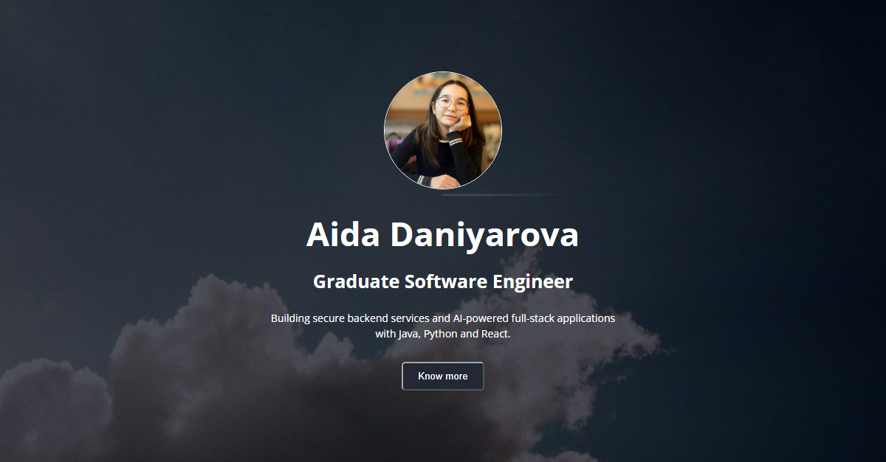

# Aida Daniyarova – Interactive CV

[](https://aida-daniyarova-cv.vercel.app)
[](https://github.com/AidaDaniyarova/CV)

A responsive CV and portfolio site built with **React 19**, **Redux Toolkit**, **React Router**, **SCSS** and **Formik/Yup**, with a mock REST API powered by **Mirage JS**.

[](https://aida-daniyarova-cv.vercel.app)

---

## Features

- Home page with photo, title and tagline, linking to the full CV
- Collapsible sidebar with section navigation (icon-only rail on mobile)
- About, Education, Experience, Skills, Portfolio and Contacts sections
- Education timeline and skills loaded from a mock API, with loading and error states
- Add a new skill through a validated form (Formik + Yup); the skills chart updates through Redux
- Portfolio filtered by category: AI, Backend, Full Stack
- Feedback section appears automatically once testimonials are added
- Back-to-top button
- Unit tests for every component (Vitest + React Testing Library)

---

## Tech Stack

| Area | Tools |
|---|---|
| UI | React 19, React Router 7, SCSS |
| State | Redux Toolkit (`createSlice`, `createAsyncThunk`), React Redux |
| Forms | Formik, Yup |
| Mock API | Mirage JS |
| Icons | Font Awesome |
| Build | Vite |
| Testing | Vitest, React Testing Library, jsdom |
| Linting | oxlint |
| Hosting | Vercel |

---

## Project Structure

```
src/
├── app/store.js            # Redux store
├── assets/                 # images and global SCSS (variables, reset, fonts)
├── components/             # Address, Box, Button, Expertise, Feedback, Info,
│                           # Navigation, Panel, PhotoBox, Portfolio, Skills, TimeLine
├── data/resumeData.js      # all CV content in one file
├── features/               # Redux slices: education, skills
├── pages/                  # Home, Inner
├── services/
│   ├── api.js              # fetch calls
│   └── server.js           # Mirage mock server
├── App.jsx                 # routes: / and /inner
└── main.jsx
```

All CV content (about text, education, experience, skills, portfolio, contacts, feedback) lives in `src/data/resumeData.js`, so you can update the CV without touching any components.

---

## Mock API

Mirage JS runs in the browser and intercepts these requests:

| Method | Endpoint | Description |
|---|---|---|
| GET | `/api/educations` | Education timeline |
| GET | `/api/skills` | Skills list |
| POST | `/api/skills` | Add a skill |

Data is kept in memory, so skills you add reset when the page reloads.

---

## Getting Started

```bash
git clone https://github.com/AidaDaniyarova/CV.git
cd CV
npm install
npm run dev
```

Then open http://localhost:5173.

---

## Scripts

| Command | Description |
|---|---|
| `npm run dev` | Start the development server |
| `npm run build` | Build for production into `dist/` |
| `npm run preview` | Preview the production build |
| `npm test` | Run tests in watch mode |
| `npm run test:coverage` | Run tests with a coverage report |
| `npx oxlint` | Lint the project |

---

## Deployment

The site is deployed on Vercel (Vite preset, output directory `dist`). `vercel.json` rewrites every route to `index.html`, so client-side routes such as `/inner` also work when you refresh the page.

---

## Author

**Aida Daniyarova** – Graduate Software Engineer, London

- GitHub: [AidaDaniyarova](https://github.com/AidaDaniyarova)
- LinkedIn: [aida-dani](https://linkedin.com/in/aida-dani)
- Email: aida.daniyarova5@gmail.com

---

## License

Built for educational and portfolio purposes.
